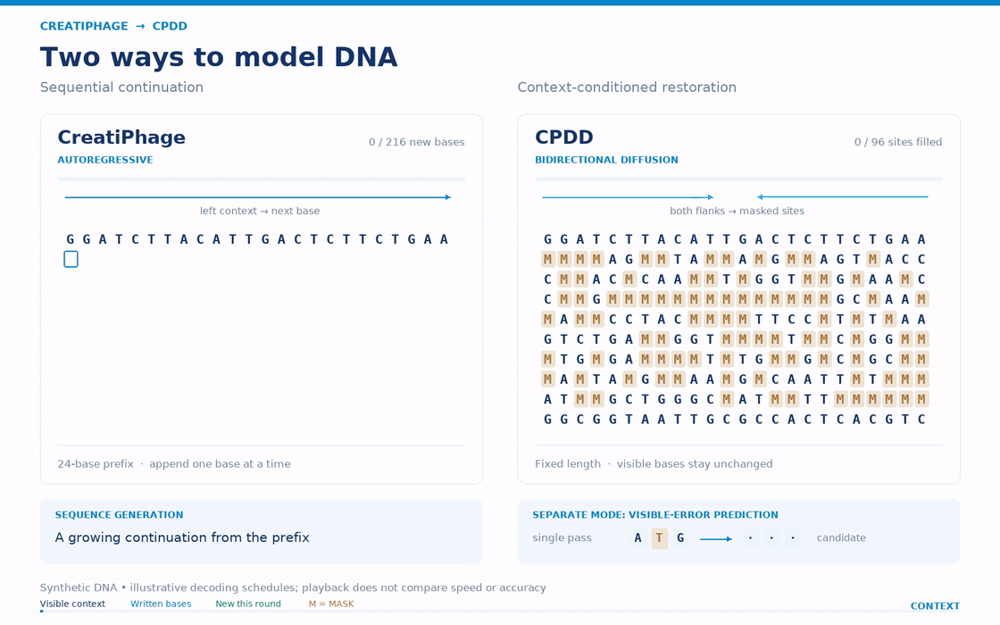
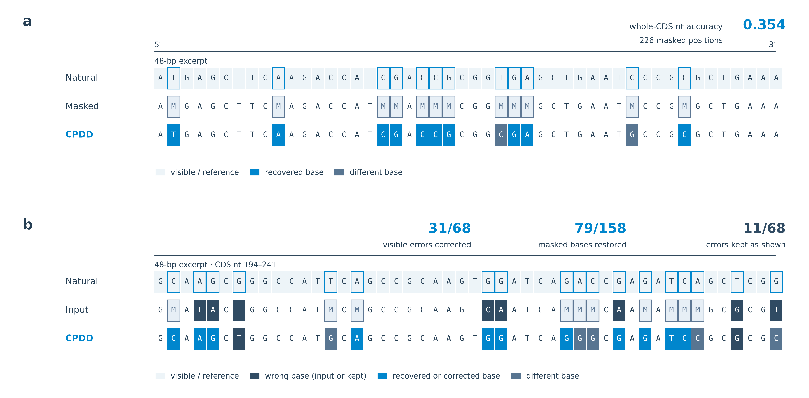

# CreatiPhage Diffusion DNA-LM (CPDD)

<p align="center">
  
</p>

<p align="center"><em>CreatiPhage AR autoregressive generation (left) and CPDD bidirectional restoration (right). The animation illustrates the interfaces, not a performance benchmark.</em></p>

Code for **CPDD: Adapting an autoregressive DNA language model for bidirectional phage genome modeling**.

CPDD is a 147.5M-parameter bidirectional discrete diffusion model initialized from the 144.5M-parameter CreatiPhage autoregressive backbone. It restores fixed-length regions within a preserved DNA scaffold. The released model configuration corresponds to the final 46,000-update training run.

[Technical report](paper/CPDD_technical_report.pdf) — pre-release manuscript snapshot.

## Repository map

- `experiments/phageseek/`: CreatiPhage 145M SWA backbone and its single released model configuration.
- `experiments/phadf/model.py`: bidirectional CPDD adapter and entropy-guided restoration.
- `experiments/phadf/restart.py`: distributed CPDD training and checkpoint resume.
- `experiments/phadf/panel_eval.py`: single-forward masked validation metrics.
- `experiments/phadf/generation_eval.py`: standalone iterative-restoration validation.
- `examples/generate_ar.py`: minimal AR generation demo.
- `examples/restore.py`: minimal CPDD restoration demo without a dataset index.

The `phageseek` and `phadf` module names are retained for checkpoint compatibility.

## Installation

Python 3.12 and PyTorch 2.12.1 were used for the released code.

```bash
git clone https://github.com/dhnihaoya/CreatiPhage-Diffusion-DNA-Lm.git
cd CreatiPhage-Diffusion-DNA-Lm
python -m venv .venv
source .venv/bin/activate
pip install -r requirements.txt
```

Run commands from the repository root. Model checkpoints and datasets are not stored in this GitHub repository.

## AR generation demo

Generate a short sequence from a primer using the released cached AR decoder. `--length` is the total token count, including BOS and the primer:

```bash
python examples/generate_ar.py \
  --checkpoint /path/to/creatiphage_145m.pt \
  --primer ATGCGT --length 16 --device cpu
```

Use `--device cuda` for GPU inference. The JSON omits the initial BOS and reports both the full sequence and the newly generated continuation. `#` marks EOS; `*` after EOS marks PAD.

## CPDD restoration demo

The following masks bases 9–27 of a synthetic 36 bp context and restores them in six steps:

```bash
python examples/restore.py \
  --checkpoint /path/to/step_46000.pt \
  --sequence ATGCGTACGTTAGGCTAACCGATCGTACCTGATAGC \
  --start 9 --end 27 --steps 6 \
  --decoding argmax --device cpu
```

Use `--device cuda` for GPU inference and `--decoding categorical` for sampled restoration. The JSON output includes the restored sequence, target accuracy, and a check that all visible bases remained unchanged. Coordinates are zero-based and half-open.

A real restoration example from the technical report:



The minimal public demo covers MASK restoration. The mixed visible-error repair illustrated in panel b is not part of this minimal interface.

## Data preparation

This repository does **not** redistribute the training corpus or benchmark sequences. The training pipeline uses the public megaDNA sequence collection reconstructed from NCBI GenBank, MGV v1.0, and GPD, together with geNomad CDS annotations.

Place locally prepared inputs at:

```text
data/train/training_set.fasta
data/split/manifest.csv                 # id,source,split,length_bp
data/annotations/training_genomad/      # geNomad shard outputs
```

Then build the CPDD dataset index:

```bash
python -m experiments.phadf.build_dataset \
  --repo-root "$PWD" --output data/cpdd_dataset --stage all --workers 4
```

## Diagnostic validation

Run iterative whole-CDS and gap-restoration validation on a locally prepared panel. This is a diagnostic entry, not a reproduction of the complete 522-CDS/70-cluster benchmark:

```bash
python -m experiments.phadf.generation_eval \
  --checkpoint /path/to/step_46000.pt \
  --repo-root "$PWD" \
  --dataset-dir data/cpdd_dataset \
  --val-panel data/cpdd_dataset/panels/pilot_val.jsonl \
  --output results/generation.json
```

Training calls `panel_eval.score_panel` for single-forward CE, nucleotide accuracy, amino-acid loss, ORF, and codon-diversity metrics. `generation_eval.py` reports iterative whole-target and gap-restoration results.

Run the CPU regression suite with:

```bash
CUDA_VISIBLE_DEVICES= python -B -m unittest discover \
  -s experiments/phadf -t . -p 'test_*.py' -v
```

## Scope

CPDD accepts ACGT input and restores fixed-length intervals; it does not model insertions or deletions inside the target. Computational recovery and annotation metrics do not establish biological activity. Long-gap recovery and transferable use of distant copied sequence remain limitations, as discussed in the technical report.
